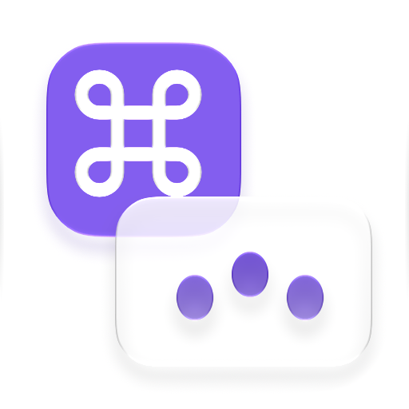
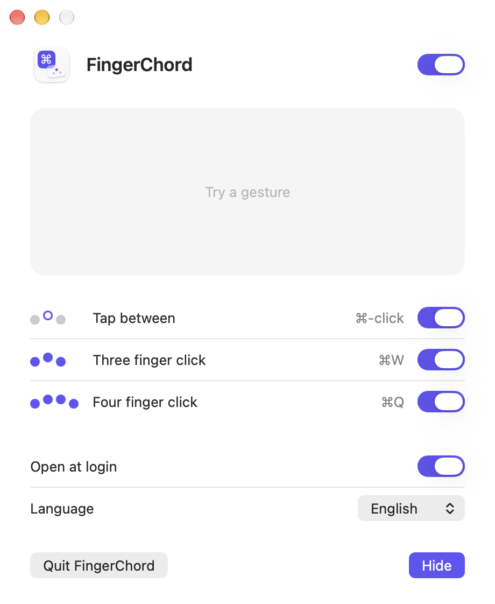

<p align="center"></p>

# FingerChord · 指间

A macOS 27 trackpad utility that maps three gestures to ⌘-click, ⌘W, and ⌘Q. Runs in the background with no Dock or menu bar icon.

**[Download FingerChord.dmg](https://github.com/heruoxin/FingerChord.app/releases/latest/download/FingerChord.dmg)** · Requires macOS 27 · Notarized by Apple

[Website](https://fingerchord.catchingnow.com/en/) · [简体中文](README.md) · [Changelog](CHANGELOG.md) · [GPLv3](LICENSE)

## Gestures

| Gesture | How | Sends |
| --- | --- | --- |
| Tap between fingers | Rest your index and ring fingers; tap your middle finger between them | ⌘-click |
| Three-finger click | Click the trackpad with three fingers | ⌘W |
| Four-finger click | Click the trackpad with four fingers | ⌘Q |

Keep the resting fingers down to tap repeatedly; each tap gives a single haptic pulse. Three- and four-finger clicks keep the trackpad’s usual click feel. Each gesture can be turned off on its own.



## Setup

1. Open the DMG, drag FingerChord into Applications, and open it.
2. Click **Allow…** and turn on Accessibility and Input Monitoring in System Settings → Privacy & Security.
3. While the settings window is in front, gestures only appear in the trackpad preview. Switch to another app and they work normally.
4. Click **Hide** or close the window to leave FingerChord running in the background. Open the app again to get back to settings.

## Limitations

- ⌘W and ⌘Q are sent by US key position, so other layouts may produce different characters; ⌘-click is unaffected.
- Relies on the private MultitouchSupport interface and supports macOS 27 only; future OS updates may require changes. Tested on macOS 27.2.1 with the built-in trackpad on Apple silicon Macs; the Magic Trackpad is untested.
- One- and two-finger clicks are never delayed. Clicks with three or more fingers wait up to 80 ms to check for a gesture, then go through as usual if they aren’t one.

## Footprint

Everything is event-driven, with no polling. Idle in the background it uses 0% CPU, 0 wakeups, and about 10 MB of memory (an empty AppKit process takes about 8 MB).

- Single-finger pointer frames are dropped in C and never reach Swift.
- Scrolls are not intercepted at all. The drag event tap stays off unless a click is buffered or swallowed.
- Closing the settings window hands off to a fresh background process, freeing the ~18 MB of caches SwiftUI leaves behind.
- With every gesture turned off, trackpad and event monitoring stop completely.

## Build

Requires macOS 27, Xcode with the macOS 27 SDK, and Swift 6.2+.

```sh
./scripts/test.sh             # unit tests
./scripts/build.sh            # build and sign dist/FingerChord.app
./scripts/install.sh          # build, move into /Applications, open settings
./scripts/package-release.sh  # notarized dist/FingerChord.dmg and SHA-256
./scripts/build-site.py       # website, written to .build/site
```

Builds sign with a local Developer ID or Apple Development certificate when available, falling back to ad-hoc signing. Set `FINGERCHORD_SIGN_IDENTITY` to pick a specific identity, or `-` to force ad-hoc. Rebuilds signed with the same certificate keep their system permissions; ad-hoc rebuilds may need them granted again.

Packaging requires [create-dmg](https://github.com/create-dmg/create-dmg) and a Developer ID certificate. Notarization credentials stay in your local keychain: run `xcrun notarytool store-credentials FingerChord` once and the script reads that profile, or set `FINGERCHORD_NOTARY_PROFILE` to use another.

See [development notes](docs/DEVELOPMENT.md) for architecture, diagnostics, and verification, or [CONTRIBUTING.md](CONTRIBUTING.md) if you’d like to contribute.

## Privacy

Gestures are recognized locally on your Mac. FingerChord never accesses the network and never reads keyboard input or window contents. Preferences are stored in local UserDefaults. Diagnostics are off by default; a manual recording keeps at most 3 minutes or 10,000 touch and button events in `~/Library/Application Support/FingerChord/diagnostic.json` and is never uploaded.

## Origin and license

The first version was built one-shot by GPT 6 Astra from the [original prompt](docs/ORIGINAL_PROMPT.md), written after BetterTouchTool stopped working on macOS 27. Code, icon and documentation are released under [GPL-3.0-only](LICENSE); interface references and their licenses are in [Acknowledgments](ACKNOWLEDGMENTS.md).
