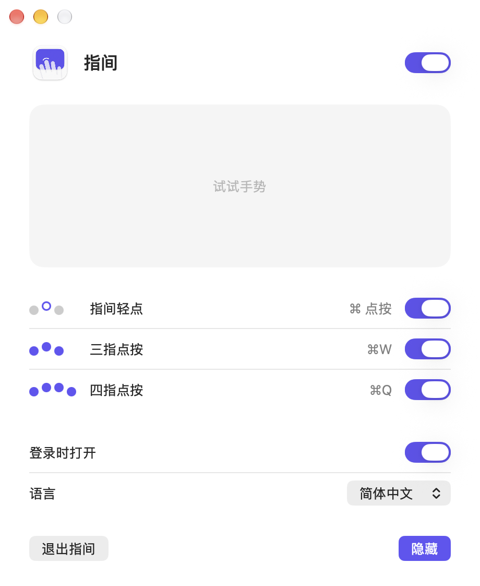

<p align="center"></p>

# 指间 · FingerChord

macOS 27 专用的触控板手势工具：用三个手势发送 ⌘ 点按、⌘W 和 ⌘Q。常驻后台，没有 Dock 和菜单栏图标。

**[下载 FingerChord.dmg](https://github.com/heruoxin/FingerChord.app/releases/latest/download/FingerChord.dmg)** · 需要 macOS 27 · 经 Apple 公证

[官网](https://fingerchord.catchingnow.com/) · [English](README.en.md) · [更新记录](CHANGELOG.md) · [GPLv3](LICENSE)

## 手势

| 手势 | 做法 | 发送 |
| --- | --- | --- |
| 指间轻点 | 食指、无名指放好，中指在两指之间轻点 | ⌘ 点按 |
| 三指点按 | 三指按下触控板 | ⌘W |
| 四指点按 | 四指按下触控板 | ⌘Q |

指间轻点时两指不用抬起，可以连续轻点，每次有一次触觉反馈；三指、四指点按保留触控板原有的按压感。三个手势都可以单独关闭。



## 使用

1. 打开下载的 DMG，把指间拖进「应用程序」并启动。
2. 首次启动按提示点「允许…」，在 系统设置 → 隐私与安全性 里打开「辅助功能」和「输入监控」。
3. 设置窗口在前台时，手势只显示在触控板预览里，不会发出去；切到别的 App 就正常生效。
4. 点「隐藏」或关闭窗口，指间会留在后台。要再打开设置，从「应用程序」或聚焦搜索里再次启动。

## 限制

- ⌘W 和 ⌘Q 按美式键盘布局的键位发送，用其他布局时可能对应到别的字符；⌘ 点按不受影响。
- 依赖私有的 MultitouchSupport 接口，只支持 macOS 27，系统更新后可能需要适配。目前只在 macOS 27.2.1、Apple 芯片内置触控板上实测过，妙控板尚未验证。
- 单指、双指点按不延迟。只有三指以上、可能构成手势的点按会等待最多 80 ms，确认不是手势就照常放行。

## 资源占用

全程事件驱动，没有轮询。后台空闲时 CPU 0%、唤醒 0 次，内存约 10 MB（空的 AppKit 进程约 8 MB）。

- 单指移动光标的触点帧在 C 层直接丢弃，不进入 Swift。
- 滚动不经过事件监听；拖移监听平时关闭，只在暂存判断或拦截一次点按期间临时开启。
- 关闭设置窗口时，由一个新的后台进程接管并退出旧进程，SwiftUI 留下的约 18 MB 缓存随之释放。
- 所有手势都关闭时，触控板和事件监听一并停止。

## 构建

需要 macOS 27、带 macOS 27 SDK 的 Xcode、Swift 6.2+。

```sh
./scripts/test.sh             # 单元测试
./scripts/build.sh            # 构建并签名 dist/FingerChord.app
./scripts/install.sh          # 构建后移入 /Applications 并打开设置
./scripts/package-release.sh  # 公证过的 dist/FingerChord.dmg 与 SHA-256
./scripts/build-site.py       # 官网，输出到 .build/site
```

构建优先使用本机的 Developer ID / Apple Development 证书，没有则退回 ad-hoc 签名。可以用 `FINGERCHORD_SIGN_IDENTITY` 指定签名证书，设为 `-` 强制 ad-hoc。用同一张证书签名时，系统授权会保留；ad-hoc 每次重新构建后可能需要重新授权。

打包需要 [create-dmg](https://github.com/create-dmg/create-dmg) 和 Developer ID 证书。公证凭据只存在本机钥匙串：先运行一次 `xcrun notarytool store-credentials FingerChord`，之后脚本按配置名读取；`FINGERCHORD_NOTARY_PROFILE` 可以换用别的配置名。

架构、诊断和验证记录见 [开发文档](docs/DEVELOPMENT.md)，参与方式见 [CONTRIBUTING](CONTRIBUTING.md)。

## 隐私

手势只在本机识别，不联网，不读取键盘输入和窗口内容。设置存在本机 UserDefaults。诊断默认关闭；手动开启后最多记录 3 分钟或 10,000 条触点与触控板按压事件，写入 `~/Library/Application Support/FingerChord/diagnostic.json`，不会上传。

## 来历与许可

初版由 GPT 6 Astra one-shot 构建，[原始需求](docs/ORIGINAL_PROMPT.md) 来自 BetterTouchTool 在 macOS 27 上失效后的自用需要。代码、图标和文档以 [GPL-3.0-only](LICENSE) 发布，接口参考及其许可见 [致谢](ACKNOWLEDGMENTS.md)。
