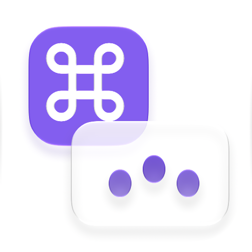

<p align="center"></p>

# 指间 · FingerChord

macOS 27 的触控板手势工具：把手指组合变成快捷键。常驻后台，没有 Dock 和菜单栏图标。

[English](README.en.md) · [更新记录](CHANGELOG.md) · [GPLv3](LICENSE)

## 手势

| 手势 | 做法 | 发送 | 默认 |
| --- | --- | --- | --- |
| 指间轻点 | 食指、无名指放稳，中指在两指之间轻点 | ⌘ 点按 | 开 |
| 左侧轻点 | 两指放稳，在它们左侧轻点一指 | 上一个标签页（⇧⌘[） | 关 |
| 右侧轻点 | 两指放稳，在它们右侧轻点一指 | 下一个标签页（⇧⌘]） | 关 |
| 三指轻点 | 三指同时轻点 | 中键点按 | 关 |
| 三指点按 | 三指按下触控板 | ⌘W | 开 |
| 四指点按 | 四指按下触控板 | ⌘Q | 开 |

轻点时有一次触感反馈；点按保留触控板本身的按压手感。放稳的两指不用抬起，可以连续轻点。


## 使用

1. 构建后把 `FingerChord.app` 放进「应用程序」，打开。
2. 点「允许…」，在 系统设置 → 隐私与安全性 里打开「辅助功能」和「输入监控」。
3. 设置窗口在前台时，手势只显示在触控板预览里，不会发送；切到别的 App 就正常生效。
4. 点「隐藏」或关闭窗口，指间留在后台。再次打开 App 回到设置。

## 限制

- 三指轻点与系统的「三指拖移」和「查询与数据检测器 · 三指轻点」冲突，启用前先在系统设置里关掉它们。
- ⌘ 点按和中键作用于指针位置，快捷键发给当前 App。按键按 US 布局发送，其他键盘布局下可能对应别的字符。
- 依赖私有的 MultitouchSupport 接口，只支持 macOS 27，系统更新后可能需要适配。已在 macOS 27.2.1、Apple Silicon 内置 Force Touch 触控板上实测，外接触控板未验证。
- 单指、双指点按从不延迟。三指以上、可能构成手势的点按最多等 80 ms，等不到就照常放行。

## 资源占用

全程事件驱动，没有轮询。后台空闲时 CPU 0%、唤醒 0 次，内存约 10 MB（一个空的 AppKit 进程约 8 MB）。

- 单指移动光标的触点帧在 C 层直接丢弃，不进入 Swift。
- 滚动和拖移不经过指间；只有按住或吞掉一次点按期间，才临时打开拖移监听。
- 关闭设置窗口时，指间交给一个新的后台进程，SwiftUI 留下的约 18 MB 缓存随旧进程释放。
- 所有手势都关掉时，触控板和事件监听一并停止。

## 构建

需要 macOS 27、带 macOS 27 SDK 的 Xcode、Swift 6.2+。

```sh
./scripts/test.sh             # 单元测试
./scripts/build.sh            # 构建并签名 dist/FingerChord.app
./scripts/install.sh          # 安装到 /Applications 并打开设置
./scripts/package-release.sh  # ZIP 与 SHA-256
```

构建优先用本机的 Developer ID / Apple Development 证书，没有就用 ad-hoc 签名。`FINGERCHORD_SIGN_IDENTITY` 可以指定身份，设为 `-` 强制 ad-hoc。用同一张证书签名，系统授权会保留；ad-hoc 每次重新构建后可能要重新授权。本地产物未经公证。

架构、诊断和验证记录见 [开发文档](docs/DEVELOPMENT.md)，参与方式见 [CONTRIBUTING](CONTRIBUTING.md)。

## 隐私

手势只在本机识别，不联网，不读取键盘输入和窗口内容。设置存在本机 UserDefaults。诊断默认关闭；手动开启后最多记录 3 分钟或 10,000 条触点与按键事件，写入 `~/Library/Application Support/FingerChord/diagnostic.json`，不会上传。

## 来历与许可

初版由 GPT 6 Astra one-shot 构建，[原始需求](docs/ORIGINAL_PROMPT.md) 来自 BetterTouchTool 在 macOS 27 上失效后的自用需要。代码、图标和文档以 [GPL-3.0-only](LICENSE) 发布，接口参考及其许可见 [致谢](ACKNOWLEDGMENTS.md)。
